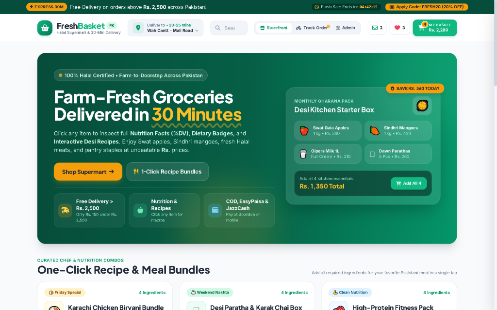

# Fresh Basket Pakistan (`velora-commerce`)

> An interactive Pakistani supermart & 30-minute express grocery web application built with HTML5, Tailwind CSS, and modular JavaScript — featuring PKR pricing, nutrition facts (`%DV`), 1-click Desi recipe bundles, simulated live rider tracking, printable receipts, and an inventory admin view.

---

## Live Demo

- **Production URL:** [https://velora-commerce-xi.vercel.app/](https://velora-commerce-xi.vercel.app/)
- **Mode:** Live interactive storefront deployed on Vercel.

## Application Preview




## Features

- **Storefront & Discovery:** 16 Pakistani grocery SKUs (Swat Gala Apples, Sindhri Mangoes, Olpers Milk, Dawn Paratha, Kernel Basmati Rice, Shan Masala, Sidr Honey, etc.) with category filtering, dietary chips (`100% Halal`, `High Protein`, `Farm Organic`, `Gluten-Free`), instant search, and sorting.
- **Interactive Nutrition Facts & Recipes:** Click any product card to view macronutrient breakdowns (`% Daily Value`), farm origin, storage tips, and 1-click recipe ingredient bundles (e.g., Karachi Chicken Biryani, Desi Nashta, High-Protein Fitness Pack).
- **PKR Cart, Promo Codes & Checkout:** Slide-over basket drawer with free-delivery progress threshold (`Rs. 2,500`), promo codes (`FRESH20` / `PAK10`), scheduled 2-hour delivery slots, payment selection UI (`COD`, `EasyPaisa`, `JazzCash`, Card), and printable digital receipts.
- **Live Rider Tracker Simulation & Admin Console:** Interactive 4-stage delivery timeline with animated route SVG, simulated email/SMS notification logs, inline PKR price editor, stock toggle, and SKU creator persisted via `localStorage`.

---

## Technology Stack

- **Frontend:** HTML5, Tailwind CSS, Font Awesome, Google Fonts (`Plus Jakarta Sans` & `Inter`), Vanilla ES6+
- **Testable Logic Module:** `src/storeLogic.js` covered by Node.js unit tests (`node --test`)
- **State Persistence:** Browser `localStorage` with one-click demo state reset

---

## Project Structure

```text
velora-commerce/
├── index.html              # Responsive storefront, tracker, and admin UI
├── src/
│   └── storeLogic.js       # Pure pricing, filtering, escaping & %DV utilities
├── tests/
│   └── freshbasket.test.mjs # Unit tests for totals, promos, filters & escaping
├── .gitignore
├── LICENSE
└── README.md
```

---

## Setup & Testing Locally

Open `index.html` directly or serve the directory with any static server:

```bash
npx serve .
```

Run automated logic tests:

```bash
node --test tests/freshbasket.test.mjs
```

---

## Scope & Limitations

- **Frontend Prototype / Interactive Demo:** Payment options (`COD`, `EasyPaisa`, `JazzCash`, Card), rider GPS progression, and notification logs operate client-side using simulated order state and `localStorage` persistence rather than live payment gateway APIs or a production backend database.

---

## Author

**Muzammil Shabbir**  
GitHub: [@Muzammil-s](https://github.com/Muzammil-s) · Email: muzammilw10@gmail.com
